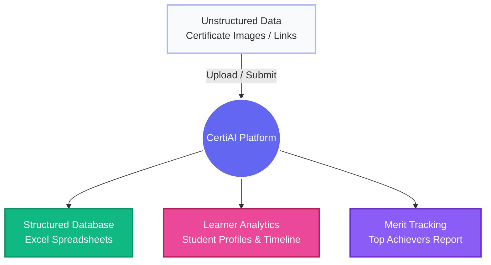
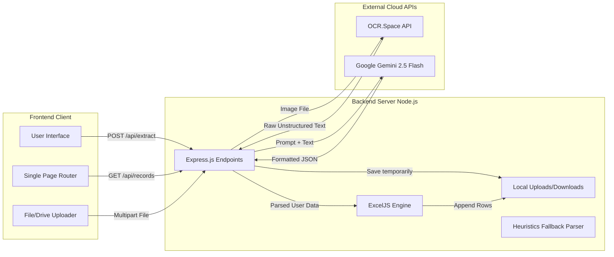
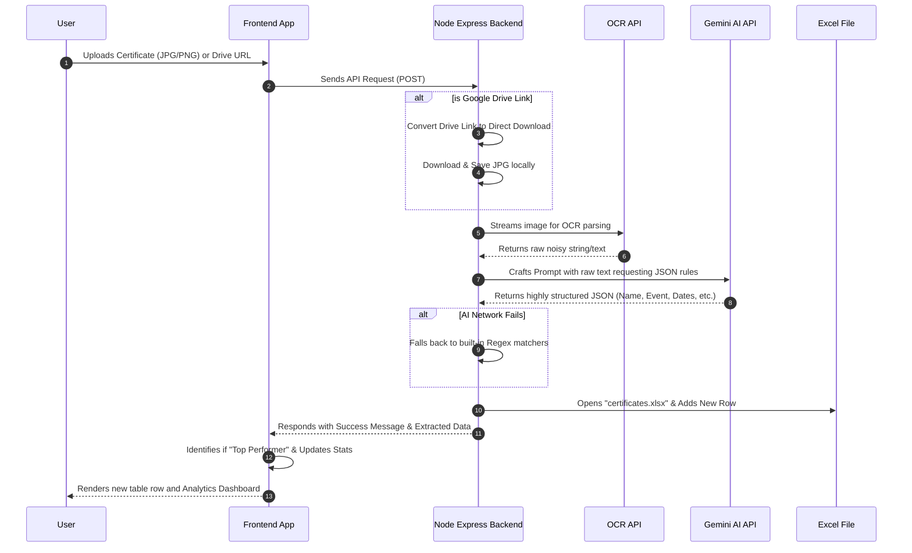

# CertiAI: AI Certificate Extraction & Automation System

## 🌟 Project Overview
**CertiAI** is an intelligent web application designed to eliminate the tedious, manual data-entry process required for logging student or employee certificates. 

By utilizing advanced **Optical Character Recognition (OCR)** and the **Google Gemini 2.5 Flash AI** model, CertiAI effortlessly visually parses unstructured certificate images (or Google Drive links) and structures key details into highly-organized, downloadable Excel reports. Furthermore, it operates as a full **Digital Credentials Management System** by providing Learner Analytics and automated top-performer tracking.

---

## 🛠 Tech Stack
* **Frontend:** HTML5, CSS3 (Glassmorphism Next-Gen UI), Vanilla JavaScript.
* **Backend:** Node.js, Express.js
* **AI & APIs:** Google Gemini 2.5 Flash API (LLM Parser), OCR.Space API (Image-to-Text).
* **Data & File System:** Multer (File Upload Handling), ExcelJS (Spreadsheet Management).

---

## 🎨 1. Concept Diagram
*This high-level diagram visualizes the overarching goal of the project: turning messy visual data into actionable intelligence.*



---

## 🏗 2. Block Diagram (Architecture)
*This diagram shows the system architecture, detailing the specific components within the frontend, the backend server, and the external cloud APIs.*



---

## 🔄 3. Process Flow Diagram
*This Sequence Diagram outlines the step-by-step logic that happens when a user clicks the "Extract Data Now" button.*



---

## 🚀 Key Features

1. **Intelligent Data Parsing:** Understands unstructured, messy formats natively relying on cognitive AI contexts rather than rigid templates.
2. **Auto-Identify Top Performers:** Recognizes "Winner", "Merit", "1st Prize", etc., and dynamically pulls these individuals into special achievement reports.
3. **Learner Analytics Dashboard:** Allows administrators to search for any individual and instantly populate a timeline of their digital credentials, calculating their dominant "Skill Domain" and proficiency automatically.
4. **Resilient Local Fallback:** In cases where internet/AI constraints drop, relies on a custom-built Regex certificate parser to ensure operations don't freeze.
5. **No Config DB:** Opts for direct-to-Excel append writing, meaning the data exported is immediately ready for institutional reporting without requiring database extraction.

---

## 💻 Installation & Setup Instructions

To run this project locally on your machine, follow these steps:

### Prerequisites
* Node.js (v16.x or newer)
* npm (Node Package Manager)

### 1. Clone the repository
Move into the project folder:
```bash
cd finalmajor
```

### 2. Install Dependencies
Install all the required Node packages (Express, Multer, ExcelJS, Axios, dotenv, etc.):
```bash
npm install
```

### 3. Environment Variables (.env)
You must create a `.env` file in the root directory and add your API keys. Without these, the application will not be able to parse text or extract data.
```env
PORT=3000
OCR_API_KEY=your_ocr_space_api_key
GEMINI_API_KEY=your_google_gemini_api_key
```
*Note: You can get a free OCR key from [OCR.space](https://ocr.space/ocrapi) and a free Gemini key from [Google AI Studio](https://aistudio.google.com/).*

### 4. Start the Application
Run the start script to launch the Node Express server:
```bash
npm start
```
*Alternatively, you can just run `node server.js` directly.*

### 5. Open in Browser
Once the server is running, you can access the completely functional UI at:
**[http://localhost:3000](http://localhost:3000)**
